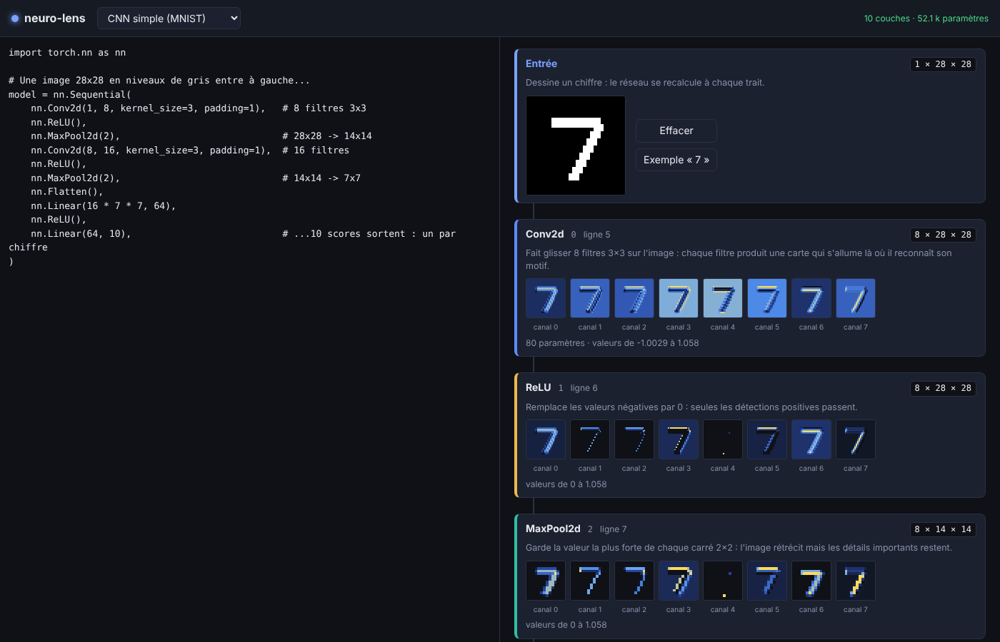

# neuro-lens

Chaque ligne de code prend forme sous tes yeux. Neuro-lens ouvre une fenêtre sur l'intérieur des réseaux de neurones : tu écris, le réseau se dessine, les filtres s'allument. Le deep learning sans boîte noire. Tu tapes une couche, elle apparaît. Tu l'entraînes, elle s'anime.



## Ce que ça fait

- **À gauche**, un éditeur Python. **À droite**, une page qui se met à jour pendant que tu tapes.
- **Lien code ↔ visuel** : le curseur sur une ligne allume l'élément correspondant ; survoler un élément surligne sa ligne.
- **Erreurs expliquées** : une erreur de taille est traduite en français (« La couche Linear attend 1568 valeurs… Mets in_features=1352 ») et la ligne fautive est soulignée.

Ce que la page montre dépend de ce que le code définit :

| Le code définit | La page montre |
| --- | --- |
| `model` : un réseau PyTorch (`nn.Sequential` ou classe `nn.Module`) | l'entrée, la vue réseau, la vue blocs, une carte par couche, la prédiction |
| `model` : un modèle scikit-learn, avec ses données `X` (et `y`) | le nuage de points, la frontière de décision, l'arbre, les poids appris |
| `graph` : un agent LangGraph, avec son état de départ `state` | le schéma des étapes, le chemin suivi, ce que chaque étape a changé |

### Réseaux PyTorch

- **Entrée** : une zone de dessin (un chiffre 28×28), ou une phrase si le modèle commence par `nn.Embedding`.
- **Vue réseau** : des neurones en colonnes reliés par des flèches, plus lumineux quand ils sont actifs.
- **Vue blocs** : le trajet réel des données, avec les raccourcis (connexions résiduelles) et les branches parallèles.
- **Une carte par couche**, avec une phrase d'explication, la forme de la sortie et le nombre de paramètres :
  - cartes d'activation des convolutions et du MaxPool, valeurs des couches denses ;
  - découpage de l'image en patchs (Vision Transformer) ;
  - vecteur de chaque token, et projection en 2D des embeddings ;
  - une grille par tête d'attention : qui regarde qui ;
  - choix du routeur dans un mélange d'experts (MoE).
- **Prédiction** finale sous forme de barres.

Les réseaux ne sont pas entraînés : les poids sont aléatoires, mais les formes, les filtres et le trajet des données sont réels.

### Modèles scikit-learn

Le modèle est entraîné sur `X`, `y` s'il ne l'est pas déjà. Le score affiché est mesuré sur ces mêmes données.

### Agents LangGraph

L'agent est exécuté pour de bon à partir de `state`. L'exemple fourni remplace le modèle de langage par une fonction simple, pour tourner sans clé d'API.

## Lancer

```bash
python -m venv .venv && source .venv/bin/activate
pip install -r requirements.txt
python -m server.app
```

Puis ouvrir http://127.0.0.1:8000.

L'éditeur (Monaco, celui de VS Code) est chargé depuis un CDN ; sans connexion, une zone de texte simple prend le relais.

## Tests

```bash
pip install -r requirements-dev.txt
pytest
```

## Comment ça marche

```
web/        page HTML/JS : éditeur, vues et cartes
server/
  app.py       serveur FastAPI ; exécute le code dans un processus séparé (limite de 10 s)
  analyzer.py  réseaux PyTorch : capture la sortie de chaque couche et le trajet des données
  ml.py        modèles scikit-learn
  agents.py    agents LangGraph
tests/
```

Le serveur exécute le code tapé dans l'éditeur : il est fait pour tourner sur ta machine (il n'écoute que sur 127.0.0.1), pas pour être exposé sur Internet.

## Pistes

- Bouton « Entraîner » sur MNIST, avec la courbe de loss et les filtres qui évoluent en direct.
- Afficher aussi les opérations fonctionnelles (`F.relu`) appelées dans `forward`.
- Un vrai tokenizer et des embeddings pré-entraînés, pour que les mots proches se rapprochent.
- Brancher un vrai modèle de langage dans l'exemple d'agent.
- Volet MLOps : suivi des expériences avec MLflow.
